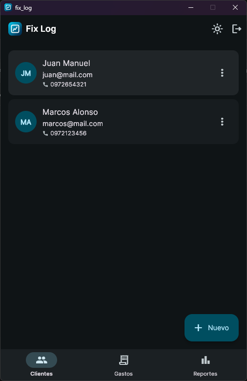
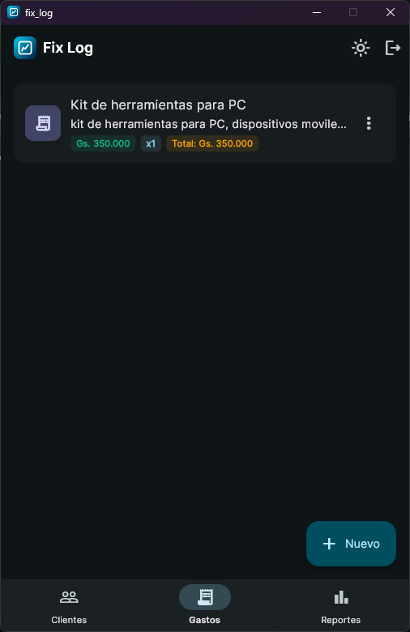
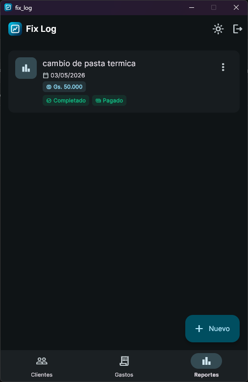
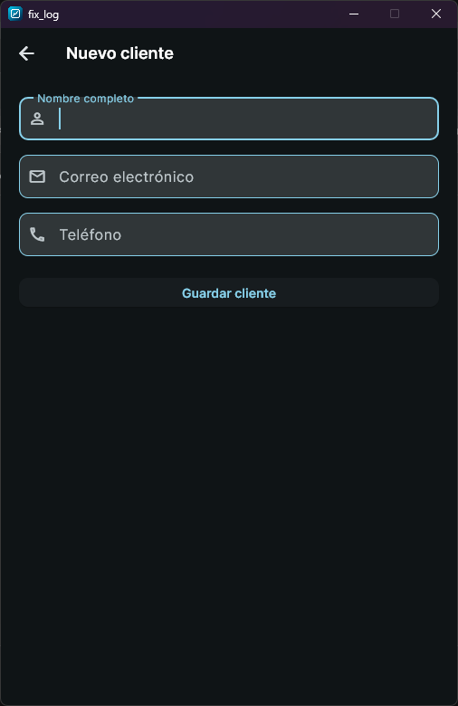
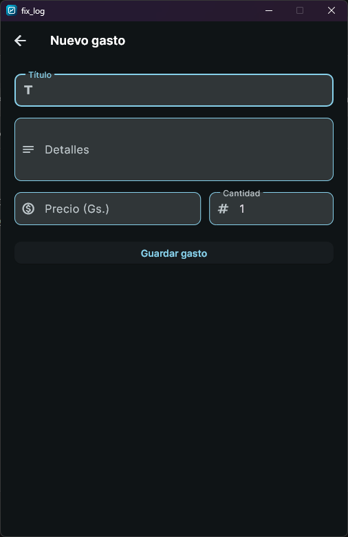
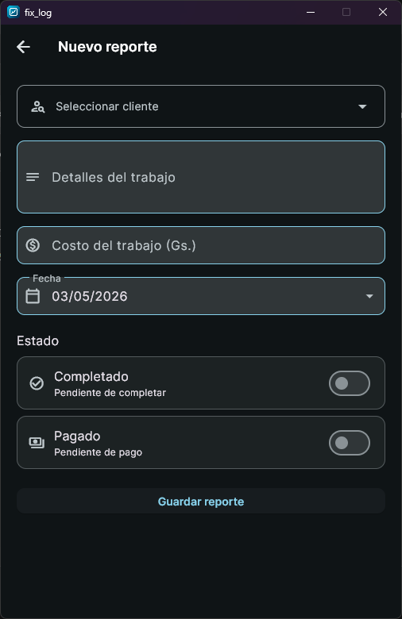
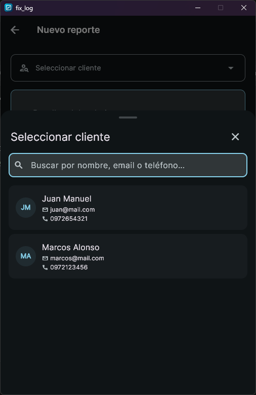

# fix_log

Aplicación de gestión para técnicos y prestadores de servicios. Permite registrar clientes, reportes de trabajo y gastos operativos, con datos completamente aislados por usuario.

El repositorio contiene dos proyectos independientes:

- **`fix-log-api/`** — backend ASP.NET Core 10, siguiendo Clean Architecture.
- **`fix_log/`** — frontend Flutter (Windows, Linux, Android, iOS), siguiendo la arquitectura UI/Domain/Data (MVVM).

## Screenshots

<table>
  <tr>
    <td align="center"><b>Clientes</b></td>
    <td align="center"><b>Gastos</b></td>
    <td align="center"><b>Reportes</b></td>
  </tr>
  <tr>
    <td></td>
    <td></td>
    <td></td>
  </tr>
  <tr>
    <td align="center"><b>Nuevo cliente</b></td>
    <td align="center"><b>Nuevo gasto</b></td>
    <td align="center"><b>Nuevo reporte</b></td>
  </tr>
  <tr>
    <td></td>
    <td></td>
    <td></td>
  </tr>
  <tr>
    <td align="center" colspan="3"><b>Selector de cliente con búsqueda</b></td>
  </tr>
  <tr>
    <td colspan="3" align="center"></td>
  </tr>
</table>

## Stack

| Capa     | Tecnología                                                |
| -------- | ---------------------------------------------------------- |
| Backend  | ASP.NET Core 10 (Clean Architecture), EF Core, PostgreSQL |
| Frontend | Flutter 3, flutter_bloc (Cubit), GetIt, go_router         |
| Auth     | JWT + BCrypt                                              |
| Docs     | Scalar UI (OpenAPI)                                       |

## Funcionalidades

- Registro e inicio de sesión con JWT.
- CRUD de clientes con historial de reportes asociados.
- CRUD de reportes con estado de completado y pago, costo y fecha.
- CRUD de gastos operativos con precio unitario y cantidad.
- Modo oscuro / claro.
- Datos completamente aislados por usuario (autorización verificada por recurso en cada operación).

## Arquitectura

### Backend — Clean Architecture

Cuatro proyectos separados, cada uno en su propio `.csproj`, con las dependencias apuntando siempre hacia adentro:

```text
Api  →  Infrastructure  →  Application  →  Domain
```

- **`Domain`** — entidades (`Customer`, `Expense`, `Report`, `User`), interfaces de repositorio y excepciones de dominio (`NotFoundAppException`, `ConflictAppException`, `InvalidCredentialsException`, `ValidationFailedException`). Sin ninguna dependencia de framework ni de paquetes externos — es una biblioteca de clases pura.
- **`Application`** — casos de uso (`AuthService`, `CustomerService`, `ExpenseService`, `ReportService`), DTOs, validadores (FluentValidation), opciones tipadas (`JwtSettings`, `BcryptSettings`) y la paginación compartida. Referencia solo `Domain`.
- **`Infrastructure`** — `AppDbContext`, configuraciones Fluent API de EF Core, implementaciones de los repositorios y los scripts de migración DbUp embebidos. Referencia `Application` y `Domain`.
- **`Api`** — el único proyecto ejecutable/publicable: controllers, `Program.cs` (composición de dependencias), middleware (manejo global de excepciones, correlation ID) y configuración. Referencia las tres capas anteriores.

Esta separación física (no solo por carpetas) es lo que hace que el sentido de las dependencias sea imposible de romper por accidente: `Domain` no puede compilar si alguien intenta hacerle referenciar Entity Framework o ASP.NET Core, porque el `.csproj` de `Domain` no tiene esas referencias.

Puntos clave del diseño:

- **Manejo de errores centralizado**: un único `IExceptionHandler` (`GlobalExceptionHandler`) mapea cada excepción de dominio a una respuesta `ProblemDetails` (RFC 7807) con un código estable (`CUSTOMER_NOT_FOUND`, `EMAIL_ALREADY_REGISTERED`, etc.) — nunca hay `try/catch` repartido por controllers o servicios.
- **Logging estructurado** con Serilog, y un `X-Correlation-Id` que se genera (o se reutiliza si el cliente lo manda) y se adjunta a cada línea de log de la request.
- **Migraciones con DbUp**, no con EF Core Migrations — ver la sección [Migraciones](#migraciones-dbup) más abajo.
- **Versionado de API por URL** (`/api/v1/...`).
- **Autorización por recurso**: cada operación verifica que el recurso pertenezca al usuario autenticado antes de leerlo o modificarlo (incluyendo relaciones cruzadas, como que un reporte solo pueda apuntar a un cliente propio).

### Frontend — UI / Domain / Data (MVVM)

La UI se organiza **por feature** (vertical); `domain/` y `data/` se organizan **por tipo** (en capas):

```text
View  →  ViewModel (Cubit)  →  Repository  →  Service
```

- **`ui/`** — una carpeta por feature (`auth/`, `customer/`, `expense/`, `report/`, `home/`), cada una con `view_models/` (el Cubit + su estado, que actúa como ViewModel) y `widgets/` (las pantallas, que son "tontas": solo layout y binding al estado del Cubit). `ui/core/` tiene el tema, los widgets compartidos y las strings.
- **`domain/`** — modelos de dominio (`Customer`, `Expense`, `Report`, `AuthResponse`) y excepciones (`AppException`).
- **`data/`** — `network/` (el `ApiClient` HTTP compartido), `services/` (un adaptador por feature contra la API, con interfaz abstracta + implementación HTTP) y `repositories/` (interfaz abstracta + implementación, la única fuente de verdad para cada tipo de dato).
- **`core/`** (fuera de `ui/domain/data`) — composición de dependencias (`GetIt`), configuración de rutas (`go_router`), logger y el error boundary global de la app.

Puntos clave del diseño:

- **Un ViewModel nunca depende de un Service directamente** — solo del `Repository` (abstracto). El `AuthRepository`, por ejemplo, es quien decide guardar el token en el `ApiClient` tras un login exitoso; el `AuthCubit` ni sabe que `ApiClient` existe.
- **Toda dependencia inyectada tiene una interfaz** desde la primera implementación (los 4 `Repository` y los 4 `Service` del frontend).
- **La capa de datos es la única que toca excepciones "crudas"** (HTTP, sockets) — las mapea a un `AppException` tipado con un código estable antes de que le llegue a un Cubit.
- **Error boundary global** (`FlutterError.onError`, `PlatformDispatcher.instance.onError`, `ErrorWidget.builder`) para que un error inesperado nunca deje la app en una pantalla en blanco.
- **Responsive**: las pantallas de lista y de formulario usan `LayoutBuilder` para limitar el ancho del contenido en ventanas grandes (desktop/tablet) en vez de estirarlo de punta a punta.

## Estructura del repositorio

```text
fix-log/
├── docker-compose.yml     # Levanta la API + su Postgres con un solo comando
├── .env.example           # Variables opcionales para personalizar el compose
├── assets/                # Screenshots de este README
├── fix-log-api/           # Backend ASP.NET Core
│   ├── fix-log-api.slnx
│   ├── Dockerfile
│   └── src/
│       ├── Domain/
│       │   ├── Entities/
│       │   ├── Interfaces/
│       │   └── Exceptions/
│       ├── Application/
│       │   ├── DTOs/
│       │   ├── Interfaces/
│       │   ├── Services/
│       │   ├── Validators/
│       │   ├── Options/
│       │   └── Common/
│       ├── Infrastructure/
│       │   └── Data/
│       │       ├── Configurations/
│       │       └── Repositories/
│       │   (db/migration/ — scripts SQL de DbUp)
│       └── Api/
│           ├── Controllers/
│           ├── Middleware/
│           └── Program.cs
├── fix-log-api.Tests/      # Tests unitarios (xUnit + Moq + FluentAssertions)
└── fix_log/                # App Flutter
    └── lib/
        ├── core/            # DI (GetIt), router, logger, error boundary
        ├── ui/
        │   ├── core/        # Tema, widgets compartidos, strings
        │   ├── auth/
        │   ├── customer/
        │   ├── expense/
        │   ├── report/
        │   └── home/
        ├── domain/
        │   ├── models/
        │   └── exceptions/
        └── data/
            ├── network/
            ├── services/
            └── repositories/
```

## Levantar el proyecto

### Backend con Docker Compose (recomendado)

Levanta la API y su propia base PostgreSQL con un solo comando — no necesita nada instalado más que Docker:

```bash
docker compose up --build -d
```

La API queda disponible en `http://localhost:5167` y aplica las migraciones automáticamente al arrancar. Para pararlo:

```bash
docker compose down       # conserva los datos
docker compose down -v    # borra también el volumen de Postgres
```

El compose ya trae valores por defecto para desarrollo local (usuario, contraseña y secret de JWT). Si querés cambiarlos, o si el puerto `5433` de Postgres choca con otra instancia que ya tengas corriendo en tu máquina, copiá `.env.example` a `.env` y ajustá lo que necesites:

```bash
cp .env.example .env
```

### Backend sin Docker

**Requisitos:** [.NET 10 SDK](https://dotnet.microsoft.com/download), PostgreSQL corriendo en `localhost:5432`.

```bash
# 1. Crear la base de datos
docker run --name postgres -e POSTGRES_PASSWORD=admin -p 5432:5432 -d postgres:16

# 2. Crear los archivos de configuración (no se trackean en git)
```

Creá `fix-log-api/src/Api/appsettings.Development.json`:

```json
{
  "Logging": {
    "LogLevel": {
      "Default": "Information",
      "Microsoft.AspNetCore": "Warning"
    }
  },
  "ConnectionStrings": {
    "DefaultConnection": "Host=localhost;Port=5432;Database=fixlog;Username=postgres;Password=admin"
  },
  "RunMigrations": true,
  "CorsSettings": {
    "AllowedOrigins": ["http://localhost:3000"]
  }
}
```

Y `fix-log-api/src/Api/appsettings.json`:

```json
{
  "Logging": {
    "LogLevel": {
      "Default": "Information",
      "Microsoft.AspNetCore": "Warning"
    }
  },
  "AllowedHosts": "*",
  "JwtSettings": {
    "Secret": "<clave_secreta_de_al_menos_32_caracteres>",
    "Issuer": "fix-log-api",
    "Audience": "fix-log-api-clients",
    "ExpiryMinutes": 60
  },
  "BcryptSettings": {
    "WorkFactor": 12
  },
  "CorsSettings": {
    "AllowedOrigins": []
  }
}
```

> El `Secret` debe tener al menos 32 caracteres. En producción se configura vía variables de entorno, nunca hardcodeado en el archivo.

```bash
# 3. Correr la API (aplica las migraciones DbUp pendientes al arrancar)
cd fix-log-api
dotnet run --project src/Api
```

### Migraciones (DbUp)

El schema de la base de datos se gestiona con **DbUp**, no con EF Core Migrations. Los scripts SQL versionados viven en `fix-log-api/src/Infrastructure/db/migration/` (`V001__*.sql`, `V002__*.sql`, ...) y se embeben en el assembly de `Infrastructure` al compilar.

- Con `RunMigrations: true` (ya seteado tanto en el compose como en la plantilla de arriba), la app aplica los scripts pendientes al arrancar, protegido por un advisory lock de Postgres.
- Para un cambio de schema: crear `V00N__descripcion.sql` con el siguiente número secuencial. Un script ya aplicado/mergeado **nunca se edita** — un cambio posterior es un script nuevo.
- El mapeo de EF Core (Fluent API, en `Infrastructure/Data/Configurations/`) describe el schema que los scripts ya crearon, nunca lo genera. Una tabla o columna nueva necesita el script SQL y la configuración Fluent en el mismo cambio.

### Frontend

**Requisitos:** Flutter 3.x SDK.

```bash
cd fix_log
flutter pub get
flutter run
```

Para apuntar a una API en otro host (por ejemplo, si el backend corre en otra máquina de la red):

```bash
flutter run --dart-define=API_BASE_URL=http://192.168.x.x:5167/api/v1
```

> En el emulador de Android, la app usa `10.0.2.2` por defecto para alcanzar el `localhost` del host.

## Documentación interactiva de la API

Con el backend corriendo, la UI de Scalar está disponible en:

```
http://localhost:5167/scalar/v1
```

Genera la documentación a partir del OpenAPI real de los 4 controllers (rutas, parámetros, respuestas posibles por código de estado).

## Versionado

Todos los endpoints están versionados vía la URL (`/api/v1/...`). Un cambio que rompa el contrato existente (campo removido/renombrado, cambio de tipo o de semántica) se publicaría bajo `/api/v2/...`, manteniendo `v1` vivo hasta que los clientes migren.

## Endpoints

| Método | Ruta | Auth | Descripción |
|--------|------|------|-------------|
| POST | `/api/v1/auth/register` | No | Registrar usuario (rate limited) |
| POST | `/api/v1/auth/login` | No | Iniciar sesión (rate limited) |
| GET | `/api/v1/customer?page=&pageSize=` | Sí | Listar clientes (paginado) |
| GET | `/api/v1/customer/{id}` | Sí | Obtener cliente |
| POST | `/api/v1/customer` | Sí | Crear cliente |
| PUT | `/api/v1/customer/{id}` | Sí | Editar cliente |
| DELETE | `/api/v1/customer/{id}` | Sí | Eliminar cliente |
| GET | `/api/v1/expense?page=&pageSize=` | Sí | Listar gastos (paginado) |
| GET | `/api/v1/expense/{id}` | Sí | Obtener gasto |
| POST | `/api/v1/expense` | Sí | Crear gasto |
| PUT | `/api/v1/expense/{id}` | Sí | Editar gasto |
| DELETE | `/api/v1/expense/{id}` | Sí | Eliminar gasto |
| GET | `/api/v1/report?page=&pageSize=` | Sí | Listar reportes (paginado) |
| GET | `/api/v1/report/{id}` | Sí | Obtener reporte |
| POST | `/api/v1/report` | Sí | Crear reporte |
| PUT | `/api/v1/report/{id}` | Sí | Editar reporte |
| DELETE | `/api/v1/report/{id}` | Sí | Eliminar reporte |

Los endpoints de listado aceptan `page` (default `1`) y `pageSize` (default `20`, máximo `100`), y devuelven `{ items, page, pageSize, totalCount, totalPages }`.

Los endpoints marcados con **Sí** requieren el header `Authorization: Bearer <token>`. El token se obtiene en `/api/v1/auth/login` o `/api/v1/auth/register`.

## Manejo de errores

Todo error de la API devuelve el mismo shape (RFC 7807 `ProblemDetails`, con un `code` estable agregado):

```json
{
  "status": 404,
  "title": "CUSTOMER_NOT_FOUND",
  "detail": "Customer 42 was not found.",
  "code": "CUSTOMER_NOT_FOUND"
}
```

Los errores de validación (422) agregan además un array `errors` con `{ field, message }` por cada campo inválido. Cada respuesta incluye un header `X-Correlation-Id` (generado si el cliente no lo envía) que identifica la request en los logs estructurados del servidor.
